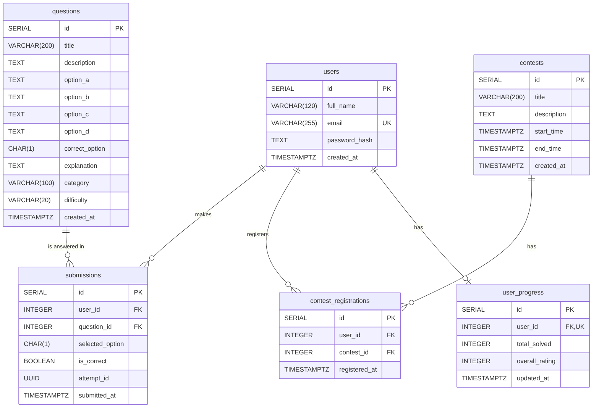

# SkillForge ER Diagram

This document explains the database structure of SkillForge. The ER diagram is available in `02_er_diagram.png`. The Mermaid source file is `er_diagram.mmd`, and the SQL schema is saved in `03_schema.sql`.

## 1. Tables

The SkillForge database contains six tables:

| Table | Purpose |
|---|---|
| `users` | Stores user details such as name, email and password hash. |
| `questions` | Stores MCQ questions, options, correct answers, categories and difficulty levels. |
| `submissions` | Stores the answers submitted by users. |
| `contests` | Stores contest details, including start and end times. |
| `contest_registrations` | Stores which users have registered for which contests. |
| `user_progress` | Stores each user's total solved questions and overall rating. |

## 2. Relationships

The tables are connected through primary keys and foreign keys.

- **Users and Submissions:** One user can submit answers to many questions. If a user is deleted, their submissions are also deleted.
- **Questions and Submissions:** One question can have many submissions. A question cannot be deleted if submissions already exist for it.
- **Users and Contests:** A user can register for many contests, and a contest can have many users. The `contest_registrations` table connects them.
- **Users and User Progress:** Each user can have only one progress record.

## 3. Keys and Constraints

**Primary Keys (PK)**

Every table has an `id` column that uniquely identifies each record.

**Foreign Keys (FK)**

Foreign keys connect related tables and maintain relationships between them.

| Column | References | On Delete |
|---|---|---|
| `submissions.user_id` | `users.id` | CASCADE |
| `submissions.question_id` | `questions.id` | RESTRICT |
| `contest_registrations.user_id` | `users.id` | CASCADE |
| `contest_registrations.contest_id` | `contests.id` | CASCADE |
| `user_progress.user_id` | `users.id` | CASCADE |

**Unique Constraints (UK)**

- `users.email` must be unique.
- `user_progress.user_id` must be unique.
- A user cannot register for the same contest more than once.

**Check Constraints**

Some rules are added to make sure the database stores valid data:

- The correct question option must be A, B, C or D.
- Difficulty must be easy, medium or hard.
- The selected answer must be A, B, C or D.
- A contest's end time must be later than its start time.
- Total solved questions and overall rating cannot be negative.

## 4. Indexes

Indexes help PostgreSQL find data faster. The schema contains these five additional indexes:

| Index Name | Table and Columns |
|---|---|
| `idx_questions_category_difficulty` | `questions (category, difficulty)` |
| `idx_submissions_user_attempt` | `submissions (user_id, attempt_id)` |
| `idx_submissions_user_id` | `submissions (user_id)` |
| `idx_submissions_question_id` | `submissions (question_id)` |
| `idx_contest_registrations_contest_id` | `contest_registrations (contest_id)` |

PostgreSQL also creates indexes automatically for primary keys and unique constraints.

## 5. Additional Notes

- `attempt_id` in the submissions table uses the UUID data type. A new UUID is generated automatically for each attempt.
- `SERIAL` is used for automatically generated ID values.
- `UK` in the ER diagram represents a Unique Key.
- `PK` represents a Primary Key, and `FK` represents a Foreign Key.

## Conclusion

The SkillForge database is designed using six related tables. Primary keys, foreign keys and constraints help maintain correct data, while indexes improve search performance. The ER diagram provides a clear view of how all the tables are connected.